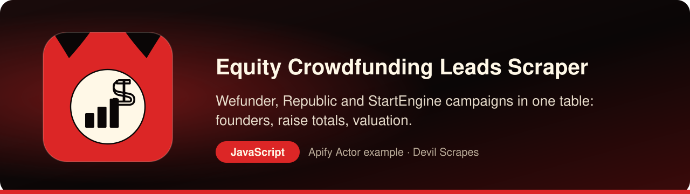

<p align="center"><a href="https://apify.com/DevilScrapes/equity-crowdfunding-leads"></a></p>

# Equity Crowdfunding Leads Scraper for JavaScript and Node.js: crowdfunding campaigns as JSON

<p align="center">
<a href="https://apify.com/DevilScrapes/equity-crowdfunding-leads"></a>

<a href="LICENSE"></a>
<a href="https://github.com/devilscrapes/equity-crowdfunding-leads-scraper-javascript/actions/workflows/ci.yml"></a>
</p>

This repository shows how to drive the **[Equity Crowdfunding Leads Scraper](https://apify.com/DevilScrapes/equity-crowdfunding-leads)** from Node.js. A single ES module built with Apify's official client sends an input object, waits for the run and hands back Wefunder, Republic and StartEngine campaigns as plain JavaScript objects with matching keys. Wefunder entries arrive with founder, pitch, location, raise progress, backer count and a numeric valuation, so a backend can store or rank them without string surgery. Apify does the collecting in the cloud, which keeps your service, serverless function or worker free of scraping code. Your app gets the leads; Apify gets the paperwork.

> **Actor:** [Equity Crowdfunding Leads Scraper](https://apify.com/DevilScrapes/equity-crowdfunding-leads) · **Publisher:** [Devil Scrapes](https://apify.com/DevilScrapes) · **Also in Python:** [equity-crowdfunding-leads-scraper-python](https://github.com/devilscrapes/equity-crowdfunding-leads-scraper-python)

## 🔥 What you get

- **A single row layout for three portals**: each campaign carries a `source` value, so Wefunder, Republic and StartEngine records sit in the same table and you filter them with one column instead of three parsers.
- **Wefunder rows come loaded**: the disclosed founder, the one-line pitch, region, goal, money raised so far, investor count, last-year revenue when published, and the pre-money valuation.
- **Valuation as a number you can sort**: shorthand such as `$62.1M` or `$700K` is turned into a plain USD float, and a value that cannot be read becomes `null` rather than a crash.
- **Honest coverage on the thinner sources**: Republic and StartEngine rows give the slug, company name and campaign link; their money fields stay `null` because those sites render them in the browser.
- **Keyword narrowing**: an optional case-insensitive substring is matched against each row's tagline or industry, and rows that match neither are left out before billing.
- **A broken portal costs you one source, not the run**: if a platform fails or stays blocked, it is logged and skipped while the remaining sources still deliver rows.
- **Throttling handled for you**: rate-limited or blocked pages are retried with growing pauses on a new proxy session before a source is given up.

## 🎯 Use cases

### Serve a live deal feed from your own API

Put the core call behind an Express or Fastify route, or inside a Next.js server action, and cache the response for a few hours. Your front end gets a ranked list of campaigns that are raising right now, with every card linking back to the original pitch page.

### Nightly CRM sync from a serverless job

Trigger `node index.js` from a cloud scheduler or a GitHub Actions cron and upsert each object using `source` together with `campaign_slug` as the key. New raises appear in your CRM as accounts overnight, and existing ones get fresh totals and investor counts.

### Push matching campaigns to a webhook

Run with `industryFilter` set to your vertical, compare the slugs with the ones you have already seen, and POST only the new campaigns to a Slack incoming webhook or your own endpoint. A small team gets a quiet channel that speaks up only when something relevant opens.

### Enrich startup profiles in a product

If your app already stores startups, look them up by company name or website and attach the crowdfunding status, `funding_stage` and amount raised. It is a cheap signal that a company is actively looking for money, refreshed whenever your worker runs.

## ⚡ Quick start

You need an Apify account and an API token from [Console → Settings → Integrations](https://console.apify.com/settings/integrations). Apify's free plan includes monthly usage credit; this Actor's event prices are listed under Pricing below.

```bash
git clone https://github.com/devilscrapes/equity-crowdfunding-leads-scraper-javascript.git
cd equity-crowdfunding-leads-scraper-javascript
npm install
export APIFY_TOKEN=your_token_here
node index.js                       # uses input.json
node index.js my-input.json --out data --max-charge 2
```

The script starts the [Equity Crowdfunding Leads Scraper](https://apify.com/DevilScrapes/equity-crowdfunding-leads), waits for it to finish, prints a link to the run in Apify Console and saves every result to `results.json` and `results.csv`. It exits with code 1 and the run's status message if the run fails.

## 🧩 The core call

The working part of the integration is the block below. `call()` resolves once the run has finished, and `listItems()` reads the run's default dataset into an array.

```javascript
import { ApifyClient } from 'apify-client';

const client = new ApifyClient({ token: 'YOUR_APIFY_TOKEN' });
const run = await client.actor('DevilScrapes/equity-crowdfunding-leads').call({"sources": ["wefunder"], "maxPerSource": 5, "statusFilter": "active", "useProxy": true});
const { items } = await client.dataset(run.defaultDatasetId).listItems();
console.log(items);
```

## 📥 Input

`index.js` forwards `input.json` exactly as written. The sample input asks Wefunder alone for five campaigns that are open for investment, which costs a few cents and shows every field. In your own code you can build the same object per request, for example a user-chosen keyword in `industryFilter`, an empty `sources` array for all three portals, or `statusFilter: "funded"` for closed rounds.

```json
{
  "sources": [
    "wefunder"
  ],
  "maxPerSource": 5,
  "statusFilter": "active",
  "useProxy": true
}
```

| Field | Type | Required | Default | Allowed values |
|---|---|---|---|---|
| `sources` | array | no | `[]` | — |
| `maxPerSource` | integer | no | `50` | — |
| `statusFilter` | string | no | `"active"` | `active`, `funded`, `all` |
| `industryFilter` | string | no | — | — |
| `useProxy` | boolean | no | `true` | — |

## 📤 Output

You receive one object per campaign. Numeric fields are real JSON numbers or `null`, `founders` is always an array (possibly empty), and `scraped_at` is an ISO 8601 string you can pass straight to `new Date()`. Treat `null` as "not disclosed" rather than zero when you render or compare values.

| Field | Type | Always present |
|---|---|---|
| `source` | string | yes |
| `campaign_slug` | string | yes |
| `company_name` | string | yes |
| `tagline` | string or null | no |
| `industry` | string or null | no |
| `location` | string or null | no |
| `founders` | array | yes |
| `website_url` | string or null | no |
| `target_amount_usd` | number or null | no |
| `raised_amount_usd` | number or null | no |
| `num_investors` | integer or null | no |
| `valuation_usd` | number or null | no |
| `revenue_usd` | number or null | no |
| `funding_stage` | string or null | no |
| `campaign_url` | string | yes |
| `scraped_at` | string | yes |

## 💰 Pricing

| Event | Price (USD) |
|---|---|
| Actor start | $0.2 |
| Campaign row | $0.005 |

Prices as configured on 2026-08-20. The [Actor page](https://apify.com/DevilScrapes/equity-crowdfunding-leads) always shows the current price. Runs are billed to the Apify account that owns the token. Use `--max-charge` to cap what a single run can cost.

## 🛠️ Working with the data in JavaScript

The script below reads the saved results with Node.js built-ins only, ranks campaigns by money raised, and writes a properly quoted CSV with one line per founder that you can hand to a CRM importer.

```javascript
import { readFile, writeFile } from 'node:fs/promises';

const rows = JSON.parse(await readFile('results.json', 'utf8'));
const cell = (value) => `"${String(value ?? '').replaceAll('"', '""')}"`;

const ranked = rows
    .filter((row) => (row.founders ?? []).length > 0)
    .sort((a, b) => (b.raised_amount_usd ?? 0) - (a.raised_amount_usd ?? 0));

const header = ['founder', 'company', 'source', 'raised_usd', 'investors', 'valuation_usd', 'url'];
const lines = [header.join(',')];
for (const row of ranked) {
    for (const founder of row.founders) {
        const values = [founder, row.company_name, row.source, row.raised_amount_usd, row.num_investors, row.valuation_usd, row.campaign_url];
        lines.push(values.map(cell).join(','));
    }
}

await writeFile('founder-leads.csv', `${lines.join('\n')}\n`);
console.log(`Wrote ${lines.length - 1} founder lines from ${ranked.length} campaigns`);
```

## ❓ FAQ

### Is there an official crowdfunding API I could call instead?

None of the three portals offers a public, documented campaign API. This Actor gives your backend one stable JSON contract for all of them, and the only secret your service has to hold is an Apify token.

### How do I trigger it from a webhook or a serverless function?

Import `ApifyClient`, start the run with `client.actor('DevilScrapes/equity-crowdfunding-leads').start(input)` and return immediately, then let an Apify webhook on run success call your endpoint, which fetches the dataset. That keeps short-lived functions well under their timeout.

### What does a test call cost?

Each run pays a start fee plus a small charge per campaign row, as listed under Pricing. Keep `maxPerSource` low while you build, and add `--max-charge 0.5` to `node index.js` so a typo in the input can never turn into a large bill.

### What if one of the portals is down?

That portal is skipped and logged, and the run continues with the others. Your code should therefore expect a result set that sometimes has no rows for one `source` value, and not treat it as an error.

## 🧯 Troubleshooting

- **`Set APIFY_TOKEN first`**: export the token in the same shell, or put it in a local `.env` file your shell loads. Never commit it.
- **Run finished with `FAILED` or `ABORTED`**: open the printed Console link; the run log says why. Input validation errors name the field.
- **Fewer rows than expected**: a `--max-charge` cap also limits how many results can be charged. Raise the cap or lower the limits in your input.
- **Something looks wrong in the data**: open an issue on the [Actor page](https://apify.com/DevilScrapes/equity-crowdfunding-leads) so the maintainers see it.

## 🔗 More from Devil Scrapes

- [Equity Crowdfunding Leads Scraper on Apify Store](https://apify.com/DevilScrapes/equity-crowdfunding-leads)
- [Python version of this example](https://github.com/devilscrapes/equity-crowdfunding-leads-scraper-python)
- [All Devil Scrapes Actors](https://apify.com/DevilScrapes)
- [Apify web scraping cookbook](https://github.com/devilscrapes/apify-web-scraping-cookbook)

Related Actors:

- [SEC EDGAR Filings Scraper — 10-K, 10-Q & 8-K](https://apify.com/DevilScrapes/sec-edgar-filings-scraper) — follow a crowdfunded issuer to its filings on SEC EDGAR.
- [New Business Filings — US State Registry Leads Feed](https://apify.com/DevilScrapes/new-business-filings-leads-scraper) — freshly registered US companies from state registries, for an even earlier signal.
- [OpenCorporates Alternative — US Business Registry Scraper](https://apify.com/DevilScrapes/opencorporates-alternative-scraper) — confirm a company's registration status and officers in US state registries.

---

MIT licensed example code. The Actor itself runs on [Apify](https://apify.com/DevilScrapes/equity-crowdfunding-leads) and is maintained by [Devil Scrapes](https://apify.com/DevilScrapes). Not affiliated with Wefunder, Republic or StartEngine.
